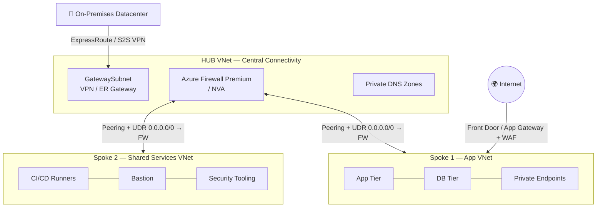
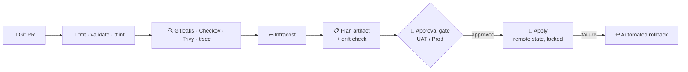
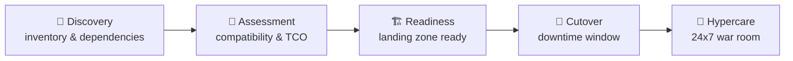

<h1 align="center">
  
  <br>
  <a href="https://git.io/typing-svg">
    
  </a>
</h1>

<p align="center">
  
  <a href="https://drive.google.com/file/d/1NM0YT_uRSXG6S4tKwD47B3GF6WAhz4dG/view?usp=drive_link"></a>
  <a href="https://www.linkedin.com/in/harsh4404/"></a>
  <a href="mailto:harshagarwal.4404@gmail.com"></a>
</p>

<h3 align="center">I design cloud platforms that are <i>scalable, secure, governed and cost-aware</i> — and automate everything in between.</h3>

---

## 💫 About Me


- 🏢 Currently building @ <a href="https://www.linkedin.com/company/hansa-solutions-india-pvt-ltd/">Hansa Solutions India Pvt Ltd</a>
- ☁️ Focused on **Azure landing zones, Infrastructure as Code, DevSecOps pipelines and cloud migration**
- 🧠 I start every design with one question: **"What is the business, and what is the functional domain?"**
- 🔭 B.Tech (CSE) — 2024 graduate, DIT University 🎓
- 📝 I write about cloud architecture, ADRs and post-mortems on [Medium](https://medium.com/@harshagarwal2225/)
- 📫 **harshagarwal.4404@gmail.com** · ⚡ Fun fact: I travel a lot to places near where I live

<br clear="right"/>

---

## 🏛️ The 10 Pillars I Build Against

Every workload I design or migrate is measured against these pillars:

| | | | | |
|:---:|:---:|:---:|:---:|:---:|
| 📈 **Scalable** | 🧱 **Robust** | 🔐 **Secure** | ✅ **Reliable** | 📦 **Portable** |
| 🧭 **Governed** | ♻️ **Highly Available** | 💰 **Cost-Optimized** | 💾 **Backed Up** | 📊 **Compliant & Monitored** |

---

## 🧩 Core Expertise

<details open>
<summary><b>🏗️ Enterprise Governance & Landing Zones (Microsoft CAF)</b></summary>
<br>

I follow the **Cloud Adoption Framework** end to end: **Strategy → Plan → Ready → Adopt → Govern → Secure & Manage**.

```
                        [ Microsoft Entra ID Tenant ]
                                      |
                            [ Tenant Root Group ]
                                      |
       +------------------------------+------------------------------+
       |                              |                              |
 [ Platform MG ]            [ Landing Zones MG ]          [ Sandbox / Decommissioned ]
  |-- Identity (AD/DNS)       |-- Corp   (internal only)
  |-- Management (Logs/Mon)   |-- Online (public / DMZ)
  `-- Connectivity (Hub/FW)   `-- Dev | UAT | Prod subscriptions
```

- **Subscription boundaries** per environment and function to isolate blast radius and avoid noisy neighbours
- **Azure Policy & Initiatives** (CIS Benchmark, MCSB) assigned at Management Group scope, with audit/deny effects and time-bound, documented exemptions
- **Group-based RBAC + PIM** — just-in-time privileged access with multi-stage approvals

</details>

<details open>
<summary><b>🌐 Hub-and-Spoke Networking</b></summary>
<br>



- **IPAM first** — audit on-prem CIDRs so no Azure VNet address space overlaps
- **Centralised inspection** — UDRs force default and inter-spoke traffic through the firewall
- **Controlled ingress/egress** — WAF at the edge, TLS-inspected egress through the hub
- **Private-only PaaS** — Private Endpoints for Key Vault, Storage and SQL, resolved through hub-linked Private DNS Zones

</details>

<details open>
<summary><b>🛡️ Defense-in-Depth Security</b></summary>
<br>

| Layer | Controls |
| :--- | :--- |
| **Identity** | Microsoft Entra ID, Conditional Access, MFA, PIM, Managed Identities over secrets |
| **Network** | Hub-and-spoke, NSG/ASG micro-segmentation, Azure Firewall Premium, Private Endpoints, DDoS Protection |
| **Governance** | Azure Policy, CIS / ISO 27001 benchmarks, Defender for Cloud Secure Score |
| **Compute** | Defender for Servers, vulnerability scanning, disk encryption with CMK, automated patch baselines |

</details>

<details open>
<summary><b>⚙️ Terraform & DevSecOps Pipelines</b></summary>
<br>



- **Remote state** in a private Azure Storage Account — blob-lease locking, encrypted at rest, reached via least-privilege Managed Identity
- **Reusable modules** with strict semantic versioning
- **Nightly drift detection** using `terraform plan -detailed-exitcode` to catch manual portal changes
- **Trunk-based development** with short-lived `feature/*` and `fix/*` branches
- **Branch policies on `main`:** no direct push, no delete, PR with 2 senior reviewers, `CODEOWNERS` enforced
- **Bootstrapping** via Cloud-Init / custom data for baseline config and agent install

</details>

<details>
<summary><b>🚚 End-to-End Cloud Migration (100+ workloads · Dev / UAT / Prod)</b></summary>
<br>



| Phase | Checklist |
| :--- | :--- |
| **Pre-migration** | Azure Migrate discovery, dependency mapping, bandwidth sizing, landing zone verification, backup verification |
| **Cutover** | DB replication sync, DNS TTL reduction, traffic rerouting, validation tests |
| **Post-migration** | Health telemetry, user sanity testing, performance benchmarks, 2–4 weeks of hypercare |

</details>

<details>
<summary><b>💰 FinOps — Cloud Financial Management</b></summary>
<br>

- **Eliminate waste:** unattached disks, stale snapshots, orphaned public IPs, idle compute
- **Rightsize** using 30-day CPU/memory utilisation percentiles
- **Commit smartly:** 1- or 3-year Reserved Instances and Azure Savings Plans for steady-state load
- **Schedule** automatic start/stop for non-production outside business hours
- **Tune log ingestion** with Data Collection Rules to drop noisy diagnostics at the source

</details>

<details>
<summary><b>💾 Backup, DR & High Availability</b></summary>
<br>

| Concept | Approach |
| :--- | :--- |
| **Storage redundancy** | LRS (3 copies, 1 datacenter) → ZRS (3 zones) → GRS (paired region) |
| **HA compute** | VM Scale Sets across Availability Zones |
| **RTO** | Maximum tolerable downtime before service is restored |
| **RPO** | Maximum tolerable data loss, e.g. ≤ 15 minutes of transactions |
| **Region strategy** | Active primary region, Azure Site Recovery replicating to the paired region |

</details>

<details>
<summary><b>📡 Observability</b></summary>
<br>

- Central **Log Analytics Workspace** per landing zone
- **Azure Monitor Agent** with DCR filtering at source for cost and performance
- **Action Groups** routing alerts to Teams, Slack or PagerDuty by severity

</details>

<details>
<summary><b>🤝 Leadership, Vendor & Delivery Governance</b></summary>
<br>

```
RFI ─▶ RFP ─▶ Technical Evaluation Matrix ─▶ SOW & Commercials ─▶ Sprints & Milestones ─▶ Acceptance Sign-off
```

- **Team growth:** KT sessions, mentoring juniors, sitting on interview panels
- **Pre-sales:** estimates, POCs, RFP/RFI responses
- **Vendor governance:** SOW scope and acceptance criteria, scored evaluation matrices, SLA tracking
- **RACI & escalation matrices** so every deliverable has one accountable owner and a clear escalation path
- **Delivery hygiene:** SOPs, runbooks, incident retrospectives, ADRs, and structured handover before sign-off

</details>

---

## 🛠️ Tech Stack

**☁️ Cloud & Platform**<br>


**🏗️ IaC & Config Management**<br>


**🔁 CI/CD & GitOps**<br>


**📦 Containers & Orchestration**<br>


**🔐 DevSecOps**<br>


**📡 Observability & FinOps**<br>


**💻 Scripting**<br>


<details>
<summary><b>👨‍💻 Software development background</b></summary>
<br>


</details>

---

## 🧭 How I Work

```
Business & Functional Domain
        │
        ├── Infrastructure Design ─▶ Landing Zones · IaC · DevSecOps · Migration · Governance · DR · FinOps
        │
        └── Application Design   ─▶ Microservices vs Monolith · API Gateway & Service Mesh · Caching · Event-Driven
```

> I work across the delivery chain — **Pre-Sales → TAM → Enterprise Architecture → Technical Lead** — so designs stay grounded in commercial reality and are actually shippable.

---

## 🌐 Connect

[](https://www.linkedin.com/in/harsh4404/)
[](https://medium.com/@harshagarwal2225/)
[](https://leetcode.com/agarwal1102/)
[](https://auth.geeksforgeeks.org/user/agarwal_harsh)
[](https://linktr.ee/agarwal_harsh)
[](https://instagram.com/harshagarwal_1102/)

---

## 📊 GitHub Stats

<p align="center">
  
  
</p>
<p align="center">
  
</p>

## 🏆 GitHub Trophies

<p align="center">
  
</p>

## 🎮 Fun

<p align="center">
  
</p>

<p align="center"><i>“Automate the boring, govern the critical, and measure everything.”</i></p>
