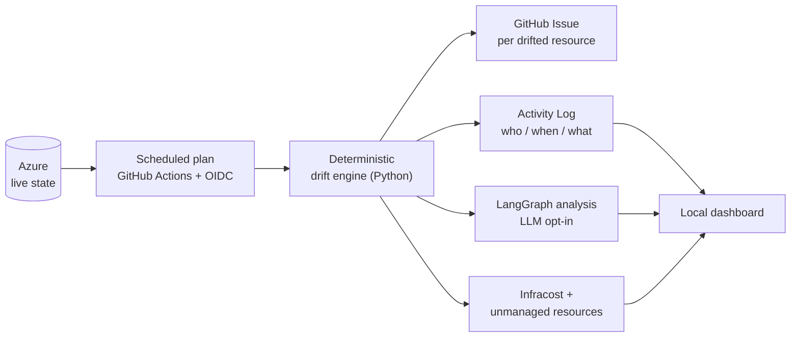
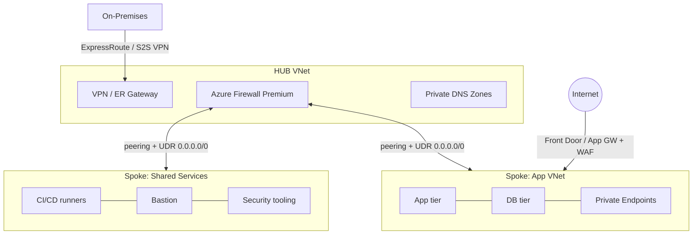
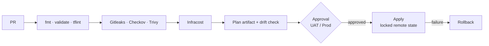
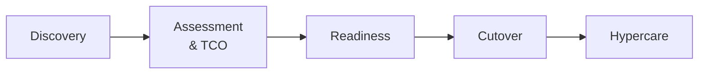

<picture>
  <source media="(prefers-color-scheme: dark)" srcset="assets/banner-dark.svg">
  <source media="(prefers-color-scheme: light)" srcset="assets/banner-light.svg">
  
</picture>

<p align="center">
  <a href="https://drive.google.com/file/d/1NM0YT_uRSXG6S4tKwD47B3GF6WAhz4dG/view?usp=drive_link"></a>
  <a href="https://harshagarwal-portfolio.netlify.app/"></a>
  <a href="https://www.linkedin.com/in/harsh4404/"></a>
  <a href="https://medium.com/@harshagarwal2225/"></a>
  <a href="mailto:harshagarwal.4404@gmail.com"></a>
</p>

<p align="center">
  
</p>

> I design and automate **Azure platforms that are scalable, secure, governed and cost-aware**: landing zones, hub-and-spoke networks, Terraform with policy guardrails, and pipelines that catch drift, secrets and cost surprises before production does.
> Every design starts from one question: **what is the business, and what is the functional domain?**

---

## ⚡ At a Glance

```yaml
# $ kubectl get engineer harsh-agarwal -o yaml
apiVersion: people/v1
kind: Engineer
metadata:
  name: harsh-agarwal
  labels:
    role: devsecops-cloud-engineer
    cloud: azure
spec:
  currentlyAt: Hansa Solutions India Pvt Ltd
  platform:  [azure-landing-zones, hub-and-spoke, entra-id, azure-policy, pim]
  iac:       [terraform, bicep, cloud-init]
  pipelines: [github-actions, azure-devops, oidc-federation, sha-pinned-actions]
  security:  [tflint, trivy, checkov, gitleaks, trufflehog, defender-for-cloud]
  finops:    [infracost, azure-retail-prices-api, rightsizing, reservations]
  aiops:     [python, langgraph]
  education: "B.Tech CSE, DIT University (2024)"
status:
  building: ai-terraform-drift-detector Level 2 (local-first CLI)
  openTo:   [platform-engineering, cloud-architecture, devsecops]
```

---

## 🚀 Featured Engineering

### 🔍 [AI-Powered Terraform Drift Detection & Remediation Platform](https://github.com/HarshAgarwal1102/ai-terraform-drift-detector)


Finds out when Azure no longer matches Terraform, explains **who changed what, when, and what it costs**, and raises it before it becomes an incident.



| Engineering rigour | |
| :--- | :--- |
| ✅ **2,885 tests**, 98.85 % coverage of the drift engine | 🧪 **135-case** end-to-end matrix with failure injection |
| 🔐 OIDC trust limited to `main`, **no client secrets** | 📌 Every workflow action **pinned by full commit SHA** |
| 🛡️ TFLint · Trivy · TruffleHog in CI | 🚦 Protected `main`: PR + **6 required checks** |
| 💰 Flagged 5 resources created outside Terraform in a live Azure test (≈ $44.85/mo list price) | 🧭 Remediation designed human-in-the-loop: safety spec first, no write access |

### 🏗️ [Azure Infrastructure Landing Zone](https://github.com/HarshAgarwal1102/Azure-Infra-Landing-Zone)


A modular, fully automated Azure landing zone in Terraform.

- **9 reusable modules:** VNet, Subnet, Application Gateway, Load Balancer, Bastion, Key Vault, VM, Public IP, Resource Group
- **Environment separation:** `preprod` and `prod` compose the same modules with their own variables
- **Bootstrap stage** creates the remote-state storage idempotently, with TLS 1.2 and no public blob access
- **Pipeline:** bootstrap → `init` / `validate` / `plan` → `apply`, with Gitleaks secret scanning

---

## 🏛️ The 10 Pillars I Build Against

| | | | | |
|:---:|:---:|:---:|:---:|:---:|
| 📈 **Scalable** | 🧱 **Robust** | 🔐 **Secure** | ✅ **Reliable** | 📦 **Portable** |
| 🧭 **Governed** | ♻️ **Highly Available** | 💰 **Cost-Optimized** | 💾 **Backed Up** | 📊 **Compliant & Monitored** |

---

## 🧩 How I Design

<details>
<summary><b>🏗️ Enterprise governance & landing zones (Microsoft CAF)</b></summary>
<br>

**Strategy → Plan → Ready → Adopt → Govern → Secure & Manage**

```
                        [ Microsoft Entra ID Tenant ]
                                      |
                            [ Tenant Root Group ]
                                      |
       +------------------------------+------------------------------+
       |                              |                              |
 [ Platform MG ]            [ Landing Zones MG ]          [ Sandbox / Decommissioned ]
  |-- Identity (AD/DNS)       |-- Corp   (internal only)
  |-- Management (Logs/Mon)   |-- Online (public / DMZ)
  `-- Connectivity (Hub/FW)   `-- Dev | UAT | Prod subscriptions
```

- **Subscription boundaries** per environment and function to contain blast radius
- **Azure Policy initiatives** (CIS, MCSB) at Management Group scope; audit/deny with time-bound, documented exemptions
- **Group-based RBAC + PIM** for just-in-time privileged access with multi-stage approval

</details>

<details>
<summary><b>🌐 Hub-and-spoke networking</b></summary>
<br>



- **IPAM first:** no overlap between on-prem CIDRs and Azure address spaces
- **Forced tunnelling** of default and inter-spoke traffic through the firewall
- **Private-only PaaS** through Private Endpoints and hub-linked Private DNS

</details>

<details>
<summary><b>🛡️ Defense in depth</b></summary>
<br>

| Layer | Controls |
| :--- | :--- |
| **Identity** | Entra ID, Conditional Access, MFA, PIM, Managed Identities instead of secrets |
| **Network** | NSG/ASG micro-segmentation, Azure Firewall Premium, Private Endpoints, DDoS Protection |
| **Governance** | Azure Policy, CIS / ISO 27001 benchmarks, Defender for Cloud Secure Score |
| **Compute** | Defender for Servers, vulnerability scanning, CMK disk encryption, patch baselines |

</details>

<details>
<summary><b>⚙️ Terraform delivery pipeline</b></summary>
<br>



- Remote state in private Storage with blob-lease locking, reached through a least-privilege Managed Identity
- Semantically versioned modules · nightly `plan -detailed-exitcode` drift checks
- Trunk-based development; `main` protected with no direct push, 2 reviewers and `CODEOWNERS`

</details>

<details>
<summary><b>🚚 Migration of 100+ workloads (Dev / UAT / Prod)</b></summary>
<br>



| Phase | Checklist |
| :--- | :--- |
| **Pre-migration** | Azure Migrate discovery, dependency mapping, bandwidth sizing, backup verification |
| **Cutover** | Replication sync, DNS TTL reduction, traffic rerouting, validation tests |
| **Post-migration** | Telemetry, user sanity tests, performance benchmarks, 2–4 weeks of hypercare |

</details>

<details>
<summary><b>💰 FinOps · 💾 DR · 📡 Observability</b></summary>
<br>

| Area | Practice |
| :--- | :--- |
| **FinOps** | Remove orphaned disks, snapshots and IPs; rightsize on 30-day P95; Reservations and Savings Plans; non-prod schedules; DCR log filtering |
| **DR / HA** | LRS → ZRS → GRS by criticality; VMSS across zones; ASR to the paired region; explicit RTO and RPO per workload |
| **Observability** | Central Log Analytics per landing zone; Azure Monitor Agent with DCRs; Action Groups to Teams, Slack or PagerDuty |

</details>

<details>
<summary><b>🤝 Leadership & delivery governance</b></summary>
<br>

`RFI → RFP → Evaluation matrix → SOW → Milestones → Acceptance sign-off`

- Knowledge-transfer sessions, mentoring, interview panels
- Pre-sales estimates, POCs and RFP responses
- RACI and escalation matrices with one accountable owner per deliverable
- SOPs, runbooks, ADRs and blameless retrospectives

</details>

---

## 🛠️ Toolbox

<p align="center">
  <br>
  <br>
  
</p>

<p align="center">
  
  
  
  
  
  
  
  
  
</p>

---

## ✍️ Latest Writing

<!-- BLOG-POST-LIST:START -->
- [What is DevOps? A Simple & Complete Guide for Beginners](https://medium.com/@harshagarwal2225/what-is-devops-9066e3f22cb8) <sub>· Nov 2025</sub>
- [My Virtual Internship Experience at Oasis Infobyte](https://medium.com/@harshagarwal2225/my-virtual-internship-experience-at-oasis-infobyte-60b2b6a90a07) <sub>· Oct 2023</sub>
- [About TicTacToe Game](https://medium.com/@harshagarwal2225/about-tictactoe-game-1a1351c327fd) <sub>· Jun 2023</sub>
<!-- BLOG-POST-LIST:END -->

---

## 📈 Activity

<picture>
  <source media="(prefers-color-scheme: dark)" srcset="https://raw.githubusercontent.com/HarshAgarwal1102/HarshAgarwal1102/output/github-snake-dark.svg">
  <source media="(prefers-color-scheme: light)" srcset="https://raw.githubusercontent.com/HarshAgarwal1102/HarshAgarwal1102/output/github-snake.svg">
  
</picture>

<p align="center">
  
  
</p>

---

## 🤖 This Profile Is Code

This README is maintained the way I run infrastructure: versioned, automated and least-privilege.

| Workflow | What it does |
| :--- | :--- |
| [](.github/workflows/snake.yml) | Regenerates the contribution snake daily and publishes it to the `output` branch |
| [Dependabot](.github/dependabot.yml) | Keeps every action, pinned by commit SHA, up to date |
| 🔒 Branch protection | `main` is locked and PR-only, just like production |

Header and terminal art are hand-built SVGs in [`assets/`](assets), with dark and light variants.

<details>
<summary>🦖 Off duty</summary>
<br>
<p align="center">
  
</p>
<p align="center">I travel a lot to places near where I live, and I'm always up for a conversation about life, cloud, or both.</p>
</details>

<p align="center"><sub><i>Automate the boring · Govern the critical · Measure everything</i></sub></p>
